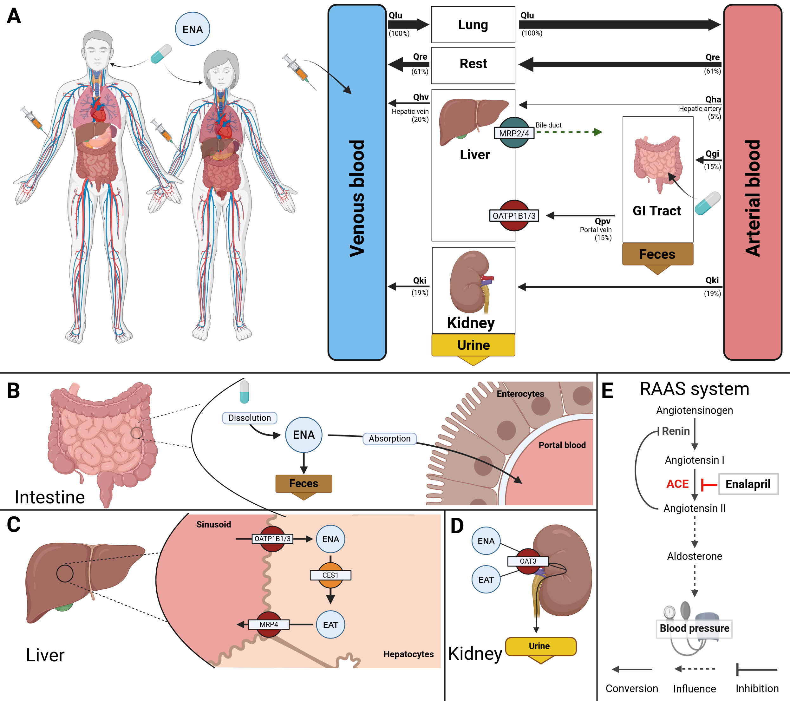

[](https://doi.org/10.5281/zenodo.11109907)
<!-- [](https://github.com/matthiaskoenig/enalapril-model/actions/workflows/python.yml)
[](https://github.com/matthiaskoenig/enalapril-model/actions/workflows/docker.yml) -->


# Enalapril model
This repository provides the enalapril physiologically based pharmacokinetics/pharmacodynamics (PBPK/PD) model.

The model is distributed as [SBML](http://sbml.org) available from [`enalapril_body_flat.xml`](./models/enalapril_body_flat.xml) with the COMBINE archive available from [`enalapril_model.omex`](./enalapril_model.omex).

The model is distributed as [SBML](http://sbml.org) available from [`enalapril_body_flat.xml`](./models/enalapril_body_flat.xml) with 
corresponding [SBML4humans model](https://sbml4humans.de/model_url?url=https://raw.githubusercontent.com/matthiaskoenig/enalapril-model/main/models/enalapril_body_flat.xml) and [equations](./models/enalapril_body_flat.md).

The COMBINE archive is available from [`enalapril_model.omex`](./enalapril_model.omex).



### Comp submodels
The liver submodel is available from [`enalapril_liver.xml`](./models/enalapril_liver.xml) with corresponding [SBML4humans](https://sbml4humans.de/model_url?url=https://raw.githubusercontent.com/matthiaskoenig/enalapril-model/main/models/enalapril_liver.xml) and [equations](./models/enalapril_liver.md).

The kidney submodel is available from [`enalapril_kidney.xml`](./models/enalapril_kidney.xml) with corresponding [SBML4humans](https://sbml4humans.de/model_url?url=https://raw.githubusercontent.com/matthiaskoenig/enalapril-model/main/models/enalapril_kidney.xml) and [equations](./models/enalapril_kidney.md).

The intestine submodel is available from [`enalapril_intestine.xml`](./models/enalapril_intestine.xml) with corresponding [SBML4humans](https://sbml4humans.de/model_url?url=https://raw.githubusercontent.com/matthiaskoenig/enalapril-model/main/models/enalapril_intestine.xml) and [equations](./models/enalapril_intestine.md).

The RAAS submodel is available from [`enalapril_raas.xml`](./models/enalapril_raas.xml) with corresponding [SBML4humans](https://sbml4humans.de/model_url?url=https://raw.githubusercontent.com/matthiaskoenig/enalapril-model/main/models/enalapril_raas.xml) and [equations](./models/enalapril_raas.md).

The whole-body submodel is available from [`enalapril_body.xml`](./models/enalapril_body.xml) with corresponding [SBML4humans report](https://sbml4humans.de/model_url?url=https://raw.githubusercontent.com/matthiaskoenig/enalapril-model/main/models/enalapril_body.xml) and [equations](./models/enalapril_body.md).

## How to cite
[](https://doi.org/10.5281/zenodo.11109907)

> Myshkina, M., & König, M. (2025).
> *Physiologically based pharmacokinetic/pharmacodynamic (PBPK/PD) model of enalapril.*   
> Zenodo. [https://doi.org/10.5281/zenodo.11109907](https://doi.org/10.5281/zenodo.11109907)

## License

* Source Code: [MIT](https://opensource.org/license/MIT)
* Documentation: [CC BY-SA 4.0](https://creativecommons.org/licenses/by-sa/4.0/)
* Models: [CC BY-SA 4.0](https://creativecommons.org/licenses/by-sa/4.0/)

This program is distributed in the hope that it will be useful, but WITHOUT ANY
WARRANTY; without even the implied warranty of MERCHANTABILITY or FITNESS FOR A
PARTICULAR PURPOSE.

## Run simulations
### python
Clone the repository 
```bash
git clone https://github.com/matthiaskoenig/enalapril-model.git
cd enalapril-model
```

#### uv
Setup environment with uv (https://docs.astral.sh/uv/getting-started/installation/)
```bash
uv sync
```
Run the complete analysis:
```bash
uv run run_enalapril -a all -r results
```

#### pip
If you use pip install the package via
```bash
pip install -e .
```
Run the complete analysis in the environment via:
```bash
run run_enalapril -a all -r results
```

### docker
Simulations can also be run within a docker container:

```bash
docker run -v "${PWD}/results:/results" -it matthiaskoenig/enalapril:latest /bin/bash
```

Run the complete analysis:
```bash
uv run run_enalapril -a all -r /results
```
The results are written into the mounted `/results` folder on the host.

In case of permission issues with the mounted folder, adjust ownership and access rights with:
```bash
sudo chown $(id -u):$(id -g) -R "${PWD}/results"
sudo chmod 775 "${PWD}/results"
```

## Funding
Mariia Myshkina was supported by the Federal Ministry of Education and Research (BMBF, Germany) within ATLAS by grant number 031L0304B and by the German Research Foundation (DFG) within Priority Programme SPP 2311 by grant number 465194077 (Subproject SimLivA).
Matthias König was supported by the Federal Ministry of Research, Technology and Space (BMFTR, Germany) within ATLAS by grant number 031L0304B and by the German Research Foundation (DFG) within the Research Unit Program FOR 5151 QuaLiPerF (Quantifying Liver Perfusion-Function Relationship in Complex Resection - A Systems Medicine Approach) by grant number 436883643 and by grant number 465194077 (Priority Programme SPP 2311, Subproject SimLivA). This work was supported by the BMBF-funded de.NBI Cloud within the German Network for Bioinformatics Infrastructure (de.NBI) (031A537B, 031A533A, 031A538A, 031A533B, 031A535A, 031A537C, 031A534A, 031A532B).


© 2024-2026 Shubankar Palwankar, Mariia Myshkina and Matthias König, [Systems Medicine of the Liver](https://livermetabolism.com)