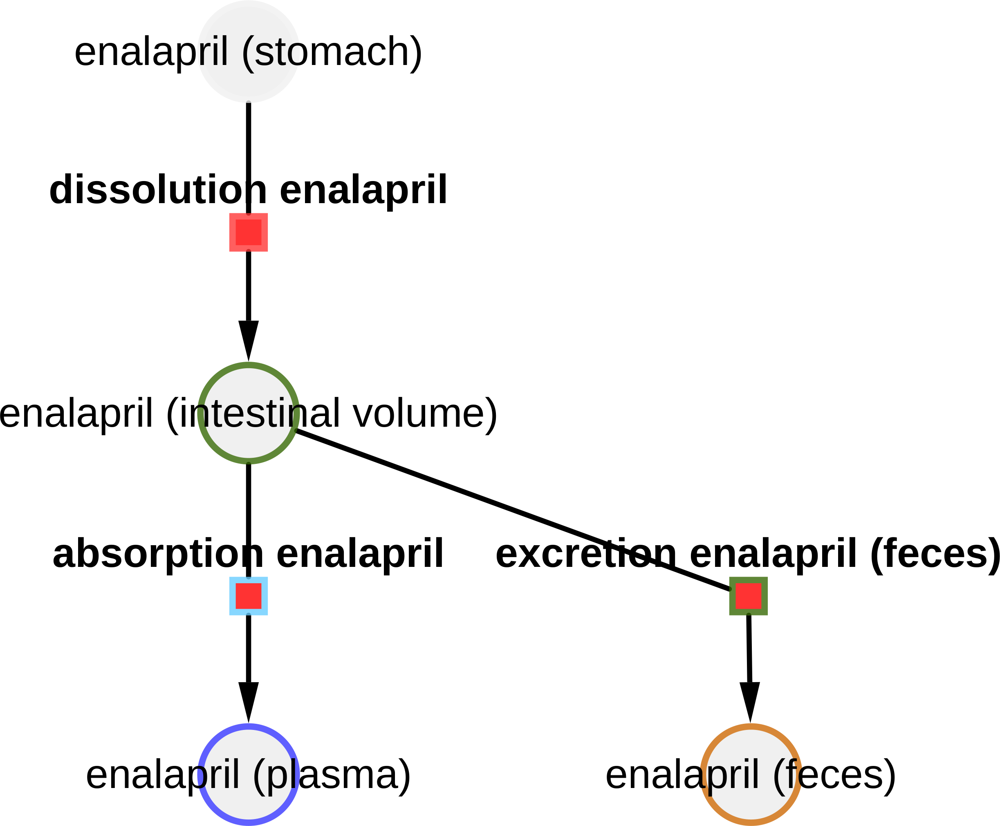
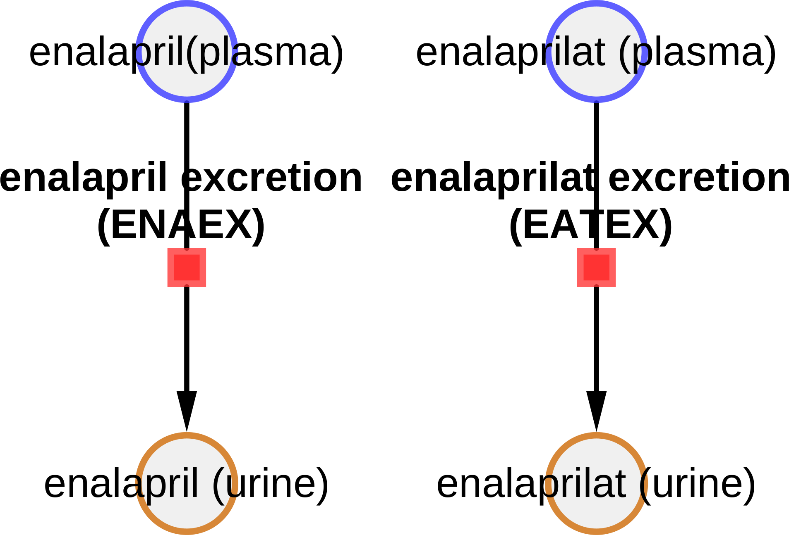
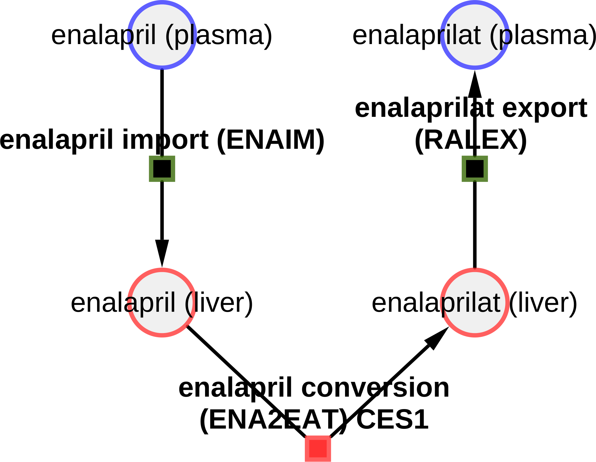

# Models

The models are distributed in [SBML](http://sbml.org) format.

## enalapril_body

* Model: [`enalapril_body.xml`](https://raw.githubusercontent.com/matthiaskoenig/enalapril-model/main/models/enalapril_body.xml)
* Equations: [`enalapril_body.md`](https://github.com/matthiaskoenig/enalapril-model/blob/main/models/enalapril_body.md)
* Report: [SBML4humans](https://sbml4humans.de/report?url=https%3A%2F%2Fraw.githubusercontent.com%2Fmatthiaskoenig%2Fenalapril-model%2Fmain%2Fmodels%2Fenalapril_body.xml)

{ style="max-height: 420px; width: auto; max-width: 100%" }

## enalapril_body_flat

* Model: [`enalapril_body_flat.xml`](https://raw.githubusercontent.com/matthiaskoenig/enalapril-model/main/models/enalapril_body_flat.xml)
* Equations: [`enalapril_body_flat.md`](https://github.com/matthiaskoenig/enalapril-model/blob/main/models/enalapril_body_flat.md)
* Report: [SBML4humans](https://sbml4humans.de/report?url=https%3A%2F%2Fraw.githubusercontent.com%2Fmatthiaskoenig%2Fenalapril-model%2Fmain%2Fmodels%2Fenalapril_body_flat.xml)

## enalapril_intestine

* Model: [`enalapril_intestine.xml`](https://raw.githubusercontent.com/matthiaskoenig/enalapril-model/main/models/enalapril_intestine.xml)
* Equations: [`enalapril_intestine.md`](https://github.com/matthiaskoenig/enalapril-model/blob/main/models/enalapril_intestine.md)
* Report: [SBML4humans](https://sbml4humans.de/report?url=https%3A%2F%2Fraw.githubusercontent.com%2Fmatthiaskoenig%2Fenalapril-model%2Fmain%2Fmodels%2Fenalapril_intestine.xml)

{ style="max-height: 420px; width: auto; max-width: 100%" }

## enalapril_kidney

* Model: [`enalapril_kidney.xml`](https://raw.githubusercontent.com/matthiaskoenig/enalapril-model/main/models/enalapril_kidney.xml)
* Equations: [`enalapril_kidney.md`](https://github.com/matthiaskoenig/enalapril-model/blob/main/models/enalapril_kidney.md)
* Report: [SBML4humans](https://sbml4humans.de/report?url=https%3A%2F%2Fraw.githubusercontent.com%2Fmatthiaskoenig%2Fenalapril-model%2Fmain%2Fmodels%2Fenalapril_kidney.xml)

{ style="max-height: 420px; width: auto; max-width: 100%" }

## enalapril_liver

* Model: [`enalapril_liver.xml`](https://raw.githubusercontent.com/matthiaskoenig/enalapril-model/main/models/enalapril_liver.xml)
* Equations: [`enalapril_liver.md`](https://github.com/matthiaskoenig/enalapril-model/blob/main/models/enalapril_liver.md)
* Report: [SBML4humans](https://sbml4humans.de/report?url=https%3A%2F%2Fraw.githubusercontent.com%2Fmatthiaskoenig%2Fenalapril-model%2Fmain%2Fmodels%2Fenalapril_liver.xml)

{ style="max-height: 420px; width: auto; max-width: 100%" }

## enalapril_raas

* Model: [`enalapril_raas.xml`](https://raw.githubusercontent.com/matthiaskoenig/enalapril-model/main/models/enalapril_raas.xml)
* Equations: [`enalapril_raas.md`](https://github.com/matthiaskoenig/enalapril-model/blob/main/models/enalapril_raas.md)
* Report: [SBML4humans](https://sbml4humans.de/report?url=https%3A%2F%2Fraw.githubusercontent.com%2Fmatthiaskoenig%2Fenalapril-model%2Fmain%2Fmodels%2Fenalapril_raas.xml)

## COMBINE archive

The models and the metadata are available as COMBINE archive from [`enalapril_model.omex`](https://raw.githubusercontent.com/matthiaskoenig/enalapril-model/main/enalapril_model.omex).
