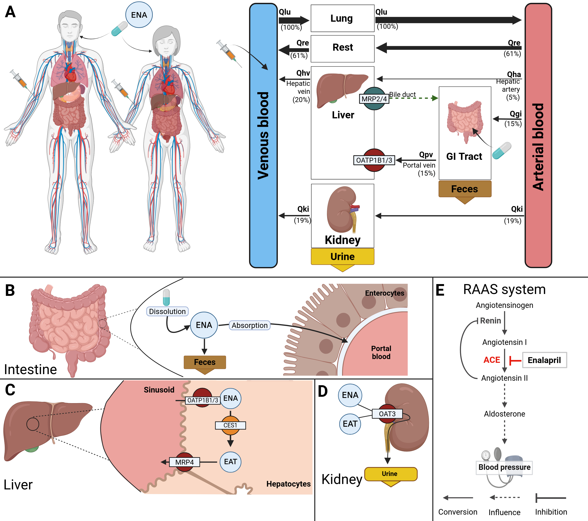

[](https://doi.org/10.5281/zenodo.11109907)

# enalapril model
This archive provides the enalapril physiologically based pharmacokinetics/ pharmacodynamics (PBPK/PD) model:
the absorption of the prodrug enalapril, its hydrolysis by the hepatic carboxylesterase 1 (CES1) to the
active enalaprilat, the distribution of both and the binding of enalaprilat to tissue ACE, their renal
excretion relative to the glomerular filtration rate, and the inhibition of ACE in the
renin-angiotensin-aldosterone system (RAAS) with its effect on angiotensin I and II, renin, aldosterone and
the blood pressure.
The model is developed in the model folder `pkdb_models/models/enalapril` of the repository
[pkdb_models](https://github.com/matthiaskoenig/pkdb_models), with its
[documentation](https://matthiaskoenig.github.io/pkdb_models/).

The model is distributed as [SBML](http://sbml.org) format available from [`enalapril_body_flat.xml`](./models/enalapril_body_flat.xml) with
corresponding [model equations](./models/enalapril_body_flat.md).

The COMBINE archive is available from [`enalapril_model.omex`](./enalapril_model.omex).



### Comp submodels
* **liver** submodel [`enalapril_liver.xml`](./models/enalapril_liver.xml) with [equations](./models/enalapril_liver.md).
* **kidney** submodel [`enalapril_kidney.xml`](./models/enalapril_kidney.xml) with [equations](./models/enalapril_kidney.md).
* **intestine** submodel [`enalapril_intestine.xml`](./models/enalapril_intestine.xml) with [equations](./models/enalapril_intestine.md).
* **RAAS** submodel [`enalapril_raas.xml`](./models/enalapril_raas.xml) with [equations](./models/enalapril_raas.md).
* **whole-body** submodel [`enalapril_body.xml`](./models/enalapril_body.xml) with [equations](./models/enalapril_body.md).

### Fitted parameters
The values of the fitted parameters are those of the adopted fits in [`fits/`](./fits): the
pharmacokinetics `PK_20261020_114902__1f0f7` and the pharmacodynamics `PD_20261020_125416__5ce99`. Every
fitted parameter of the SBML carries its uncertainty (`distrib:uncertainty`: the profile likelihood, the
standard error of the Fisher information and the distribution of the draws).

## How to cite
[](https://doi.org/10.5281/zenodo.11109907)

> Palwankar, S. & König, M. (2026).
> *Physiologically based pharmacokinetic/pharmacodynamic (PBPK/PD) model of enalapril.*
> Zenodo. [https://doi.org/10.5281/zenodo.11109907](https://doi.org/10.5281/zenodo.11109907)

## License

* Source Code: [MIT](https://opensource.org/license/MIT)
* Documentation: [CC BY-SA 4.0](https://creativecommons.org/licenses/by-sa/4.0/)
* Models: [CC BY-SA 4.0](https://creativecommons.org/licenses/by-sa/4.0/)

This program is distributed in the hope that it will be useful, but WITHOUT ANY
WARRANTY; without even the implied warranty of MERCHANTABILITY or FITNESS FOR A
PARTICULAR PURPOSE.


## Run simulations
The simulations run from a checkout of the repository
[pkdb_models](https://github.com/matthiaskoenig/pkdb_models) with
[uv](https://docs.astral.sh/uv/getting-started/installation/), see its
[documentation](https://matthiaskoenig.github.io/pkdb_models/):
```bash
git clone https://github.com/matthiaskoenig/pkdb_models.git
cd pkdb_models
uv sync
uv run run_simulation pkdb_models.models.enalapril --action all
```
The results are written into `pkdb_models/models/enalapril/results/`.

## Funding
Matthias König was supported by the Federal Ministry of Research, Technology and Space (BMFTR, Germany) within ATLAS by grant number 031L0304B and by the German Research Foundation (DFG) within the Research Unit Program FOR 5151 QuaLiPerF (Quantifying Liver Perfusion-Function Relationship in Complex Resection - A Systems Medicine Approach) by grant number 436883643 and by grant number 465194077 (Priority Programme SPP 2311, Subproject SimLivA). This work was supported by the BMBF-funded de.NBI Cloud within the German Network for Bioinformatics Infrastructure (de.NBI) (031A537B, 031A533A, 031A538A, 031A533B, 031A535A, 031A537C, 031A534A, 031A532B).

© 2024-2026 Matthias König, [Systems Medicine of the Liver](https://livermetabolism.com)
